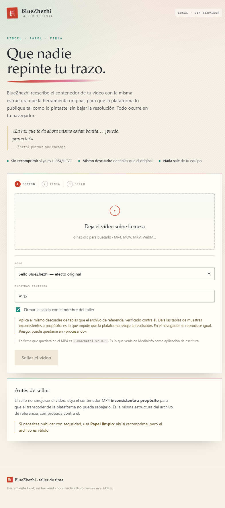

# BlueZhezhi · taller de tinta

Utilidad **local** que reescribe el contenedor de un MP4 antes de subirlo a TikTok.
No recodifica si el vídeo ya es H.264/HEVC: trabaja a nivel de átomos (boxes).

El nombre viene de Zhezhi (折枝), la pintora por encargo de *Wuthering Waves*: papel
de jade blanco, tinta, malaquita, azurita y bermellón. El taller no pinta nada por
ti, solo **protege el trazo** para que la plataforma no lo repinte.

**En línea:** <https://blues-os.github.io/BlueZhezhi/> · **En local:** `.\start.cmd`
(la versión local funciona sin conexión y sin depender de nadie).



> **Aviso honesto:** el modo sello deja el MP4 inconsistente a propósito. Funciona
> hoy y con el archivo de referencia que se comparó, pero depende de cómo valide
> TikTok ese día: puede quedarse en «procesando» para siempre o ser rechazado. Si
> necesitas publicar con seguridad, usa **Papel limpio**.

---

## Arrancar

Requisitos: Windows con PowerShell y un navegador Chromium/Firefox actualizado.
No hace falta Node, Python ni instalar nada.

```powershell
cd zhezhi
.\start.cmd
```

o manualmente:

```powershell
.\serve.ps1 -Port 5173
# abre http://localhost:5173
```

Si el puerto está ocupado: `.\serve.ps1 -Port 8080`.

El servidor solo sirve archivos estáticos de esta carpeta; no hay backend y el
vídeo nunca sale del navegador.

> La primera vez que uses un formato que no sea MP4 H.264, FFmpeg.wasm descarga
> ~32 MB desde unpkg. Se cachea en el navegador. Necesitas conexión para esa
> primera conversión; el parcheo directo funciona sin red.

---

## Cómo se usa

1. Arrastra un vídeo (MP4, MOV, MKV, WebM…).
2. Elige modo:
   - **Sello BlueZhezhi** (por defecto): aplica el descuadre de tablas que provoca
     el efecto. Es el modo que impide que la plataforma rebaje la resolución.
   - **Papel limpio**: solo normaliza el contenedor, sin descuadrar tablas. Úsalo si
     el vídeo tiene que publicarse sí o sí.
3. Pulsa **Sellar el vídeo** y descarga el MP4.

El archivo de salida termina en `_zhezhi.mp4`.

### Firma en los metadatos

| Campo | Valor |
|---|---|
| Writing application (`©too`) | `BlueZhezhi-v2.0.3` |
| Copyright (`©cprt`) | `BlueZhezhi` |
| Comment (`©cmt`) | `BlueZhezhi` |
| Compressor name (en `stsd`) | `BlueZhezhi-v2.0.3` |
| Handler de pista (`hdlr`) | `BlueZhezhi-coded` |

Se puede cambiar con las opciones `tagName` / `tagComment`, o desactivar del todo
desmarcando «Firmar la salida con el nombre del taller».

---

## Qué hace exactamente

### Pipeline

```
archivo
  └─ ¿MP4 convencional con vídeo H.264/HEVC?
       ├─ sí → patchMp4()            (sin pérdida, sin recodificar)
       └─ no → FFmpeg.wasm remux     (copia vídeo, AAC 192k)
                └─ si falla → FFmpeg.wasm transcode (libx264 CRF 20)
                     └─ patchMp4() sobre el resultado
  └─ verifyMp4()  (moov antes de mdat, offsets dentro del mdat)
```

### Papel limpio

| Transformación | Para qué |
|---|---|
| `ftyp` normalizado (`isom/iso2/avc1/mp41`) | compatibilidad de marcas |
| `moov` antes de `mdat` (faststart) | reproducción inmediata al subir |
| timestamps de creación/modificación a 0 | elimina fechas y ruido |
| `mdhd` language = `eng` | metadato de idioma consistente |
| `colr`/`nclx` BT.709 si falta | evita el "lavado" de color en otros móviles |
| elimina `uuid`, `c2pa`, `xml `, `sdtp`, `free` dentro de `moov` | quita procedencia y basura |
| `udta/meta/ilst` propio | firma la salida |

### Sello BlueZhezhi

Añade a lo anterior:

- handlers de pista renombrados (`BlueZhezhi-coded`),
- nombre del compresor en el `stsd` de vídeo (no en el de audio),
- etiquetas `©too` / `©cmt` / `©cprt` con `version/flags = 1` (no estándar),
- edit list vacía de **16 ticks** en vídeo; en audio solo se pone a cero el
  `media_time` (la duración se conserva),
- `stts` partido para separar el último sample,
- **9.112 muestras fantasma** de 8 bytes declaradas en `stsz`,
- **9.112 offsets extra** en `stco`, todos apuntando al mismo byte,
- una entrada extra en `stsc`,
- reescritura completa de offsets (incluido el paso `stco` → `co64` si hace falta).

El resultado queda **descuadrado a propósito**: `stts` declara 1.929 muestras y
`stsz` 11.041; hay 12.968 chunks para 1.928 samples reales, y al final del `mdat`
solo hay **8 bytes** de relleno, no 9.112 × 8. Los navegadores lo reproducen
igual (leen `stts`), pero un transcoder estricto se atasca o rechaza el archivo.

### Verificación

La estructura se comparó contra un archivo de referencia generado a partir del
mismo vídeo de entrada. Con la firma del taller los bytes ya no coinciden (los
textos son distintos), pero todo lo demás sí:

| | Referencia | BlueZhezhi |
|---|---|---|
| `ftyp:free:moov:mdat` | 32:8:139553:77845775 | **idéntico** |
| `stts` / `stsz` | 1.929 / 11.041 | **idéntico** |
| `stsc` | 3 entradas, última `[1929,1,1]` | **idéntico** |
| `stco` | 1928 + 9112 | **idéntico** |
| `elst` vídeo / audio | `[16,-1]` / `media_time 0` | **idéntico** |
| `mdat` final | 8 bytes de relleno | **idéntico** |
| Firma `udta` | (la del original) | `BlueZhezhi*` |

También probado con HEVC 4K (`hvc1`, 2160×3836): el parcheo no toca el códec y el
resultado se reproduce y hace *seek* sin problema.

### Qué hace la plataforma con cada caso (medido)

| Subida | Resolución | Resultado |
|---|---|---|
| 1080p con sello | 1080×1920 AVC | **archivo original intacto**, sin recomprimir |
| 1080p sin sello (Papel limpio) | 1080×1920 AVC | recomprimido y degradado a **576p** |
| 4K con sello | 2160×3836 HEVC | recomprimido, pero **conserva 2160×3836** a 9,3 Mbps |

Es decir: el sello no siempre evita el reencode. En 1080p sirvió el original tal
cual; en 4K sí transcodificó, pero **mantuvo la resolución** en vez de bajarla. Lo
que el sello parece evitar es el *downscale*, no necesariamente el *transcode*.

### Lo que **no** hace

- No cambia resolución, ni fps, ni bitrate (salvo el transcode de emergencia).
- No "mejora" la compresión: hace que la plataforma **no pueda** recomprimir.
- No sube nada a un servidor ni guarda copias.
- No añade HDR ni "4K · 120 fps".

---

## Estructura

```
zhezhi/
├─ index.html          UI (papel y tinta)
├─ assets/             favicon SVG + PNG y apple-touch-icon
├─ docs/               captura de pantalla usada en este README
├─ serve.ps1           servidor estático (HttpListener, sin dependencias)
├─ start.cmd           arranque + abrir navegador
├─ src/
│  ├─ mp4.js           parser, sellador y verificador de MP4
│  ├─ ffmpeg.js        wrapper de FFmpeg.wasm + fallback remux/transcode
│  ├─ app.js           lógica de la UI
│  └─ styles.css       paleta BlueZhezhi (papel de jade, tinta, bermellón)
├─ vendor/
│  ├─ worker.js        worker de @ffmpeg/ffmpeg 0.12.10 (mismo origen)
│  ├─ const.js
│  └─ errors.js
├─ analysis/           página de análisis estructural (los MP4 de referencia no se incluyen)
└─ test/
   ├─ test.html        prueba del sellador con un MP4 real
   ├─ sample.mp4
   └─ sample.webm
```

Abre `http://localhost:5173/test/test.html` para ver el informe del sellador,
la verificación y dos reproductores (safe/compat).

---

## Uso programático

```js
import { inspectMp4, patchMp4, verifyMp4 } from "./src/mp4.js";

const input = new Uint8Array(await file.arrayBuffer());
console.log(inspectMp4(input)); // { codec, width, height, fps, durationSec, ... }

const { bytes, report } = patchMp4(input, { mode: "compat" });
const check = verifyMp4(bytes);
console.log(report, check.ok, check.issues);

const blob = new Blob([bytes], { type: "video/mp4" });
```

Opciones de `patchMp4`:

```js
{
  mode: "compat",                  // por defecto en la UI: sello
  ghostSamples: 9112,              // solo compat: muestras fantasma declaradas
  emptyEditDuration: 16,           // solo compat: duración del edit vacío
  language: "eng",
  faststart: true,
  tagOutput: true,
  tagName: "BlueZhezhi-v2.0.3",    // en compat se ajusta solo
  tagComment: "BlueZhezhi",        // en compat se ajusta solo
  forceBt709: true,
}
```

---

## Límites

- **Memoria del navegador**: por encima de ~300 MB el procesado local puede
  fallar, sobre todo si hay que pasar por FFmpeg.wasm. El parcheo directo de un
  MP4 grande consume menos, pero sigue cargando el archivo entero en memoria
  (entrada + salida + blob: ~3× el tamaño). Para 4K de más de 500 MB, remuxea
  antes con FFmpeg de escritorio y luego pasa el resultado por el sellador.
- **FFmpeg.wasm single-thread**: es lento (aprox. 2–10× tiempo real según el
  equipo). Para vídeos largos, usa FFmpeg de escritorio y luego el sellador web.
- **Solo la primera pista de vídeo y la primera de audio**.
- **MP4 fragmentado** (`moof`/`sidx`): se convierte primero con FFmpeg.

### Flujo recomendado para vídeos grandes

```bash
# 1) remux sin pérdida (rápido)
ffmpeg -i entrada.mov -map 0:v:0 -map 0:a:0? -c copy -movflags +faststart salida.mp4

# 2) si el códec no es H.264/HEVC, recodifica con calidad alta
ffmpeg -i entrada.mov -map 0:v:0 -map 0:a:0? ^
  -c:v libx264 -preset slow -crf 18 -pix_fmt yuv420p ^
  -color_primaries bt709 -color_trc bt709 -colorspace bt709 ^
  -c:a aac -b:a 256k -movflags +faststart salida.mp4
```

Luego pasa `salida.mp4` por el sellador web para aplicar faststart/color/firma.

---

## Problemas comunes

| Síntoma | Causa / solución |
|---|---|
| "No se pudo cargar FFmpeg.wasm" | sin red o unpkg bloqueado; el parcheo directo sigue funcionando |
| Se queda en "Descargando motor" | prueba el mirror de jsdelivr (ya incluido) o usa un MP4 H.264 |
| El vídeo no reproduce tras `compat` | usa `safe`; las muestras fantasma pueden romper decodificadores estrictos |
| "Chunk offset fuera del mdat" | MP4 atípico; conviértelo primero (el modo automático lo hace) |
| El puerto 5173 está ocupado | `.\serve.ps1 -Port 8080` |

---

## Contexto

Herramienta local, sin backend, pensada para preparar un MP4 antes de subirlo a
TikTok. El modo sello reproduce el descuadre de tablas de los archivos que sí
conservan la resolución en la plataforma; el modo Papel limpio deja el contenedor
válido y se comporta como cualquier subida normal.

---

## Licencia

MIT. Haz lo que quieras con el código, pero sin garantía: el modo sello crea
archivos deliberadamente inconsistentes y la plataforma puede rechazarlos.

No está afiliado a Kuro Games, *Wuthering Waves* ni TikTok. Zhezhi y *Wuthering
Waves* son propiedad de Kuro Games; este proyecto es un homenaje no oficial.
